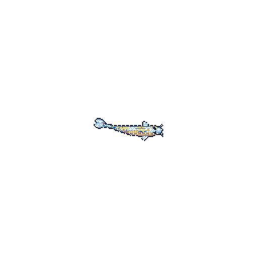

# Havish S

  

  <b>Computer Science Student | Developer | Problem Solver</b>

  Building things, solving problems, and learning something new every day.

---

### `whoami`

- 🎓 Computer Science student
- 💻 Interested in Software Development and Data Structures & Algorithms
- 🌱 Currently exploring Web Development, Backend Engineering and Systems
- ⚡ I enjoy turning ideas into working projects

### `tech_stack`

  

### `featured_projects`

| Project | Description |
|---|---|
| [UniClip](https://github.com/Havish-11/UniClip) | Real-time collaborative clipboard |
| [DeepTrace](https://github.com/Havish-11/DeepTrace-Project) | Explore the project |
| [Dev-SMP](https://github.com/Havish-11/Dev-SMP) | Explore the project |
| [Dock-it-up](https://github.com/Havish-11/Dock-it-up-assignment) | Assignment project |

### `github_stats`

  
  

  

---

  <i>Still learning. Still building. Still swimming.</i>

